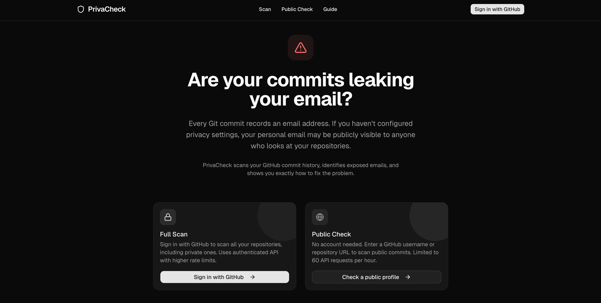

# PrivaCheck

**Find out if your personal email is exposed in your GitHub commit history.**

Every Git commit records an email address in its metadata. If you haven't configured GitHub's email privacy settings, your real email is visible to anyone — in every commit, across every public repository. PrivaCheck scans your commit history, flags exposed emails, and walks you through fixing the problem.



## Features

- **Two scan modes** — Sign in with GitHub to scan all your repos (including private), or enter any username to scan public repos with no login required.
- **Smart email classification** — Automatically distinguishes between safe GitHub noreply addresses and exposed personal emails.
- **Quick or full scan** — Check the last 100 commits per repo for a fast overview, or scan the entire commit history.
- **Real-time progress** — See which repo is being scanned, a live progress bar, and your remaining GitHub API quota.
- **Filterable results** — View all commits or just exposed ones. Click any email to filter results down to commits using that address.
- **Step-by-step fix guide** — Built-in remediation instructions to enable email privacy, update your git config, and optionally rewrite commit history.
- **Mobile-friendly** — Responsive design that works on phones, tablets, and desktops.

## Quick Start

**Prerequisites:** Node.js 20+ and npm.

```bash
# Clone the repository
git clone https://github.com/asolfre/privacheck.git
cd privacheck

# Install dependencies
npm install

# Set up environment variables
cp .env.local.example .env.local

# Start the dev server
npm run dev
```

Open [http://localhost:3000](http://localhost:3000) and you're ready to scan.

### Public mode (zero config)

The public scan works without any OAuth setup — just run the app and enter a GitHub username. You'll be limited to public repos and 60 API requests/hour.

### Authenticated mode

To scan private repos and get 5,000 API requests/hour, create a GitHub OAuth App and add the credentials to `.env.local`. See [OAUTH_SETUP.md](OAUTH_SETUP.md) for a step-by-step guide.

## Usage

### Authenticated Scan

Sign in with GitHub, then pick which repositories to scan from a searchable list. Select individual repos or use "Select All." Toggle between a quick scan (last 100 commits) or a full history scan. Results appear as each repo finishes.

### Public Scan

No login needed. Enter a GitHub username (e.g. `octocat`), a repo path (`octocat/Hello-World`), or a full GitHub URL. PrivaCheck parses the input and scans accordingly.

### Results

Each commit is classified:
- **Safe** — Uses a GitHub noreply address. No action needed.
- **Exposed** — Uses a personal email visible to anyone.

Summary cards show your total commits scanned, how many are exposed, and the number of unique emails found. Click any email badge to filter the results.

### Fix Guide

The built-in guide at `/guide` walks you through three steps:
1. Enable email privacy in your GitHub settings
2. Update your local `git config`
3. Optionally rewrite past commits to remove the exposed email

## How It Works

PrivaCheck uses the GitHub REST API to fetch commit metadata from your repositories. For each commit, it reads the author and committer email fields and classifies them against known safe patterns (GitHub noreply addresses, bot emails). Everything runs client-to-server with no database — your data is never stored.

- **Authenticated:** OAuth token gives access to private repos, 5,000 requests/hour
- **Public:** No token needed, 60 requests/hour, public repos only

## Tech Stack

| | |
|---|---|
| **Framework** | [Next.js 16](https://nextjs.org/) (App Router) |
| **Language** | [TypeScript](https://www.typescriptlang.org/) |
| **UI** | [React 19](https://react.dev/) + [shadcn/ui](https://ui.shadcn.com/) |
| **Styling** | [Tailwind CSS v4](https://tailwindcss.com/) |
| **Auth** | [NextAuth.js v5](https://authjs.dev/) |
| **Icons** | [Lucide](https://lucide.dev/) |
| **API** | [GitHub REST API](https://docs.github.com/en/rest) |

## Environment Variables

| Variable | Required | Description |
|---|---|---|
| `GITHUB_ID` | For auth mode | GitHub OAuth App Client ID |
| `GITHUB_SECRET` | For auth mode | GitHub OAuth App Client Secret |
| `NEXTAUTH_SECRET` | Yes | Session encryption key. Generate with `openssl rand -base64 32` |
| `NEXTAUTH_URL` | Yes | App URL. Use `http://localhost:3000` for local development |

## License

[MIT](LICENSE)
